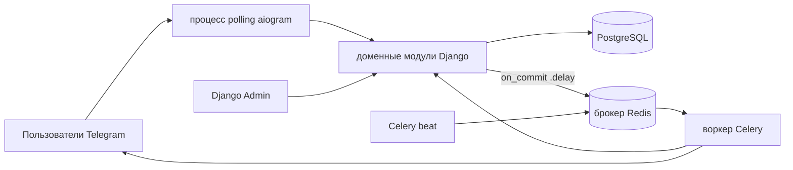

# Botera Shop — архитектура как она есть

**Статус:** поведение, которое реализовано сейчас, сверено с кодом ветки
`clean-project-rules` 2026-10-23 после батчей B0–B5, самовывоза и
упорядочивания каналов (ADR-0009). Документ описывает, что код делает
сегодня, а не задуманный дизайн. Задуманный дизайн — в
[`TARGET_ARCHITECTURE.md`](TARGET_ARCHITECTURE.md); открытые дефекты — в
[`../audits/ARCHITECTURE_AUDIT.md`](../audits/ARCHITECTURE_AUDIT.md).

**Ссылки на код:** в виде `path:symbol`, а не по номерам строк, чтобы ссылки
переживали обычные правки. Ссылки с номерами строк в реестре аудита относятся
к базовому коммиту аудита `b17ce5b` и сохранены как историческое
доказательство.

## Граница системы и процессы

Botera Shop (во внутренних именах — `tableos`) — модульный монолит на
Django 5: одна база PostgreSQL, Redis, процесс polling aiogram и воркеры
Celery. SQLite — только явный локальный режим (`DJANGO_USE_SQLITE=true`);
его поведение блокировок не соответствует PostgreSQL.



| Процесс | Точка входа | Ответственность | Модуль настроек по умолчанию |
|---|---|---|---|
| Django web/Admin | `core/wsgi.py`, `core/asgi.py`, `core/urls.py` | демо-страница, `/admin/`, `/health/` | `core.settings.production` |
| Management-команды, `runserver` | `manage.py` | миграции, наполнение демо-данными, `runbot`, `ensure_admin` | `core.settings.local` |
| Telegram-бот | `manage.py runbot` → `bot/main.py:run_polling` | polling всех активных `BotInstance` в одном процессе | `core.settings.local` (через `manage.py`) |
| Воркер Celery | `celery -A core.celery worker` → `core/celery.py` | уведомления персонала и гостей, рассылки, обновление метрик | `core.settings.local` |
| Celery beat | `celery -A core.celery beat` | из `CELERY_BEAT_SCHEDULE`: `process-scheduled-broadcast-campaigns` (1 мин), `recover-stalled-broadcast-campaigns` (5 мин), `cancel-expired-transfer-orders` (5 мин), `refresh-daily-partner-metrics` (15 мин) | `core.settings.local` |
| PostgreSQL 16, Redis 7 | `docker-compose.yml` | долговечные данные; брокер и хранилище результатов Celery | — |

`docker-compose.yml` объявляет `db`, `redis` (оба с healthcheck), разовый
`init` (`infrastructure/docker/init.sh`: проверка `BOT_TOKEN_ENCRYPTION_KEY`,
`migrate`, `seed_baseline_demo --keep-existing`, если `DEMO_SEED` не
`false`), затем `web` (Django `runserver`), `worker` (очереди
`default,broadcasts`), `beat` и `bot` (`manage.py runbot --wait`); они
стартуют только после успешного `init`. Хосты базы и Redis внутри Docker
подставляет сам compose (`db`, `redis`), рабочая копия смонтирована в `/app`.
Наружу открыт только порт web (8000); база и Redis доступны с компьютера
только с `infrastructure/docker/compose.ports.yml`.
`beat` и `bot` должны работать ровно в одном экземпляре. Пошаговый запуск —
`docs/engineering/DEVELOPMENT.md`. Все процессы, кроме веба, по умолчанию
берут `core.settings.local` (`DEBUG=True`), если `DJANGO_SETTINGS_MODULE` не
задан явно.

Admin по-русски:
- подписи моделей, полей и вариантов — `verbose_name` в моделях;
- разделы — `AppConfig.verbose_name`;
- строки темы Unfold — `LOCALE_PATHS` → `locale/ru/LC_MESSAGES/django.po`,
  `.mo` собирает `infrastructure/scripts/compile_messages.py`, gettext не
  нужен;
- проверка — `core/tests_admin_language.py`.

Продакшен (AA-038, `docs/engineering/DEPLOYMENT.md`): `docker-compose.prod.yml`
задаёт `core.settings.production` всем процессам. Модуль отказывается
стартовать со слабыми значениями (`_refuse`) и включает HTTPS-only, HSTS,
whitenoise и кэш в Redis. Сервисы:

- `init` — `check --deploy` и миграции, без демо;
- `web` — `collectstatic` и gunicorn на `127.0.0.1`;
- `worker`, `beat`, `bot`;
- `redis` с паролем;
- `backup` — `infrastructure/docker/backup.sh`, суточный `pg_dump`.

Образ ставит зависимости из `requirements.lock` и в продакшене работает от
пользователя `app`. Вход в Admin ограничен: после 5 неверных паролей
учётная запись закрыта на 15 минут (`core/security/login_throttle.py`,
`core/urls.py`). CI в репозитории нет.

Очереди: `default` и `broadcasts`; в `broadcasts` направляется только
`notifications.send_broadcast_campaign`. Поскольку `CELERY_TASK_QUEUES`
объявлены, воркер без `-Q` слушает обе очереди.

## Модули приложения и их зона

Установленные приложения по порядку: `unfold`, Django contrib, `bot`, затем
`partners`, `users`, `tables`, `menu`, `orders`, `billing`, `bonuses`,
`employees`, `notifications`, `analytics`. В `core` — общие базовые классы,
ограничение Admin по партнёру, Celery, шифрование, логирование и настройки.

| Область | Хранимые понятия | Где реальная оркестрация | Примечания |
|---|---|---|---|
| Партнёры | `Partner`, `BotInstance`, `PartnerBotSettings`, `OpeningHours` | `clean()` моделей (`Partner.clean` отклоняет неизвестные часовые пояса), `BotInstance.set_token`, `partners/opening_hours.py` | `PartnerBotSettings` хранит флаги модулей, подписи кнопок, шаблоны сообщений и реквизиты для перевода. Часовой пояс по умолчанию `Europe/Kyiv`. Часы работы поддерживают интервалы через полночь. |
| Пользователи и личность | `User`, глобальный `TelegramAccount`, партнёрский `GuestProfile`, `AdminAccessProfile`, `AdminSectionPermission` | `users/services.py:get_or_create_guest_profile` | Одна Telegram-личность → один профиль гостя на партнёра. Телефон гостя хранится в профиле. |
| Столы | `Table`, `TableSession`, `TableVisit` | `tables/services.py` | Активация по QR, визиты стола, закрытие только после расчёта. `timed_out` и `expires_at` есть, но ничто их не выставляет. |
| Меню | `MenuCategory`, `MenuItem` | чтение — `menu/repositories.py`; запись — Admin | Цена должна быть положительной (`menu_item_price_positive`). Отметки каналов: `available_at_table`, `available_for_pickup`, `available_for_delivery`; `MenuItem.is_sold_in(channel)`. |
| Заказы | `Cart`, `CartItem`, `Order`, `OrderItem`, `OrderStatusHistory` | `orders/services.py`; удалённые каналы — в `billing/remote_orders.py` | Корзина, создание заказа по каналу (стол / самовывоз / доставка / отправка), машина статусов, подтверждение получения гостем. `Order.channel`, `Order.requested_for`, `Order.payment_timing`, `Order.REMOTE_CHANNELS` (старое имя `PREPAID_CHANNELS` — синоним). |
| Счета | `BillingRequest`, `Bill`, `BillOrder`, `BillItem`, `Payment`, `BillAdjustment` | ядро — `billing/services.py`; стол — `billing/table_bills.py`; удалённые каналы — `billing/remote_orders.py` | Создание и расширение счёта, оплата деньгами и бонусами, изменения и аннулирование, действия после оплаты. |
| Бонусы | `BonusProgram`, `BonusTransaction`, `WalkInSale`, `WalkInSaleItem` | `bonuses/services.py`, `bonuses/strategies.py` | Баланс на основе журнала с проверкой сверки; быстрая продажа. |
| Сотрудники | `EmployeeProfile` | `employees/selectors.py:get_staff_employee_by_telegram` | Запись — через Admin. |
| Уведомления | `NotificationPreference`, `StaffNotification`, `BroadcastCampaign`, `BroadcastDelivery` | `notifications/services.py`, `tasks.py` | Вся отправка в Telegram — здесь. |
| Аналитика | `PartnerDailyMetric`, `TrafficSource`, `SourceVisit` | `analytics/services.py`, `analytics/sources.py` | Отчёт за день для персонала по запросу (с разбивкой по каналам заказа); снимок раз в 15 минут; источники переходов (PQ-031). |

### Фактические зависимости импорта

Целевая схема разрешает только `tables → users` и запрещает `core → apps`.
Сейчас в коде такие прямые зависимости (продакшен-модули без тестов и
миграций, включая импорты внутри функций):

```text
bot           -> все доменные приложения
analytics     -> billing, bonuses, orders, partners, tables, users
billing       -> bonuses, employees, notifications, orders, partners, tables, users
orders        -> billing, employees, menu, notifications, partners, tables, users
tables        -> billing, bonuses, notifications, orders, users
notifications -> employees, orders, partners, tables, users
bonuses       -> menu, orders, partners, users
partners      -> bonuses, employees, menu, tables, users (Admin и наполнение демо-данными)
menu          -> users
employees     -> users
core          -> partners, users (core/admin_mixins.py); orders, partners, tables (core/urls.py)
```

В `billing` зависимость от `tables` есть только у `table_bills.py`; ядро
`billing/services.py` вызывает его единственным импортом внутри функции
после оплаты (ADR-0009). `apps.notifications.services ↔
apps.notifications.tasks` — цикл, разорванный только импортами внутри
функций; принят в B5. `core → apps` остаётся в двух адаптерах:
`core/admin_mixins.py` (ограничению Admin нужны модели партнёров) и
`core/urls.py` (демо-страница, которая вне `DEBUG` отвечает только `ok` и не
раскрывает счётчики). Оба — принятые исключения-адаптеры (AA-031).

## Работа бота и маршрутизация

`bot/main.py:create_dispatcher` регистрирует `PartnerRuntimeMiddleware` как
внешний middleware обновлений и подключает роутеры в порядке `start`,
`session`, `menu`, `order`, `remote_checkout`, `profile`, `billing`,
`guest_call`, `staff`. aiogram останавливается на первом подходящем
обработчике, поэтому порядок — это поведение.

1. `bot/services/runtime.py:load_active_bot_configs` выполняется один раз при
   старте `runbot`. Процесс не запускается, если хоть один активный
   `BotInstance` принадлежит неактивному партнёру, работает в режиме webhook
   или имеет нерасшифровываемый, шаблонный, некорректный или повторяющийся
   токен, а также если активных ботов нет. С `--wait` (так запускает Docker)
   он в этих случаях не выходит, а пишет причину и перепроверяет каждые
   `--wait-interval` секунд (по умолчанию 30). Строится карта токен →
   `BotRuntimeConfig`.
2. На **каждое обновление** `bot/middlewares/partner_runtime.py` вызывает
   `bot/services/context.py:resolve_partner_for_bot_token`, который заново
   загружает `BotInstance` и `Partner`. Обновление отключённого экземпляра
   бота молча отбрасывается; приостановленный партнёр получает
   `Работа бота приостановлена, ожидайте обновлений.` (сообщением или
   всплывающим ответом на callback). Само соединение polling остаётся
   открытым до перезапуска процесса.
3. Обработчики снова вызывают `resolve_partner_for_bot_token` и строят
   `bot/services/content.py:BotContent` из `PartnerBotSettings`.
4. Действия reply-клавиатуры сопоставляются по точному тексту через
   `bot/filters/content.py:PartnerButtonFilter`; каждая проверка фильтра
   заново загружает партнёра и его тексты. `PartnerBotSettings.clean`
   отклоняет пустые и повторяющиеся подписи с маршрутизацией.
5. Обработчики персонала определяют исполнителя через
   `bot/handlers/staff.py:_resolve_staff_employee_by_telegram_id` →
   `employees/selectors.py:get_staff_employee_by_telegram`, что требует
   активного `EmployeeProfile`, активного `User` и `User.partner`, равного
   партнёру бота. Каждый callback персонала заново определяет исполнителя и
   проверяет нужное право (`_can_manage_billing`, `_can_view_tables`,
   `_ensure_open_orders_allowed`, `_ensure_quick_sale_allowed`). Права
   сочетают `User.role` с флагами модулей партнёра.

Все сообщения бота отправляются в `ParseMode.HTML` (свойства бота по
умолчанию в `bot/main.py` и `notifications/services.py:_send_telegram_messages`).
С B3.1 значения свободного текста (заведение, меню, гость, сотрудник,
комментарии, подписи) экранируются через `bot/utils/html.py:escape_html` в
боте и `notifications/services.py:_escape_html` в уведомлениях; шаблоны
партнёра — доверенная разметка с экранированными подставляемыми значениями;
текст рассылки отправляется как разметка, написанная партнёром.

## Основные сценарии домена

### Сессия гостя, меню, корзина и заказ

1. `/start table_<номер>_<токен>` → `tables/services.py:activate_table_session`
   (в боте `visit_choice="ask"`). Каждая сессия принадлежит **визиту стола**
   (`TableVisit`, ADR-0007): одна компания за столом; у стола может быть
   несколько активных визитов. Если за столом уже есть другая компания с
   сидящим гостем, бот спрашивает «Подсесть к компании (с HH:MM, гостей: N)»
   или «Начать новый визит» (callback-и `tv:j:<визит>` / `tv:n:<стол>`, UUID
   в hex); гость, уже сидящий в активном визите стола, остаётся в нём.
   Вызовы сервиса по умолчанию используют `auto` (подсесть к компании за
   столом, иначе начать новую). Начало визита, пока открыт другой визит
   стола, уведомляет персонал (`StaffNotification` категории `table_visit`).
   Активация блокирует `GuestProfile → Table → свои сессии гостя →
   TableVisit`, закрывает предыдущую активную сессию гостя у партнёра
   **независимо от неоплаченных заказов** (PQ-007), создаёт новую сессию и
   применяет бонусные программы `VISIT` с ключом идемпотентности
   `table_session:<id>:program:<id>`. Частичное уникальное ограничение
   `unique_active_table_session_per_partner_guest` гарантирует одну активную
   сессию на гостя и партнёра. Визит закрывается сам, когда в нём никто не
   сидит и он рассчитан (нет неоплаченных заказов и открытого счёта);
   `close_table_visit` — команда персонала.
2. Команды корзины в `orders/services.py` блокируют активную `Cart` гостя.
   Сначала гость выбирает способ заказа: скан QR стола или кнопка
   «Самовывоз» задают `Cart.channel` (`switch_cart_channel_for_telegram_user`
   убирает позиции, которые в этом способе не продаются —
   `MenuItem.available_at_table` / `available_for_pickup`); меню показывает
   только позиции способа корзины, и оформление идёт по нему. Корзина стола
   принадлежит сессии: корзина с позициями старой сессии забрасывается,
   пустая переносится; корзина стола, чей гость ушёл, становится корзиной
   самовывоза. Корзина самовывоза к сессии не привязывается. Без сессии
   корзина существует, только если заведение предлагает самовывоз.
   `unique_active_cart_per_partner_guest` допускает одну активную корзину на
   гостя и партнёра.
3. Оформление → `create_order`: проверяет, что гость, стол, сессия и каждая
   позиция меню принадлежат партнёру, фиксирует названия позиций и цены из
   корзины, пишет `OrderStatusHistory` и создаёт строки `StaffNotification`,
   которые отправляются через `transaction.on_commit`. Доступность позиций
   меню проверяется при добавлении в корзину, а не повторно при оформлении.
4. Смена статуса персоналом идёт через `transition_order_status`: заказ
   заново загружается с `select_for_update()` и проверяется по
   `ORDER_STATUS_TRANSITIONS`: `new → accepted|canceled`,
   `accepted → preparing|ready|canceled`, `preparing → ready|canceled`,
   `ready → delivering|completed|canceled`, `delivering → completed|canceled`.
   Завершение выставляет `received_at`.
5. **Самовывоз** (`Order.channel = pickup`, [PICKUP.md](PICKUP.md)):
   оформление корзины самовывоза выполняет
   `apps/billing/remote_orders.py:place_remote_order` — телефон обязателен,
   только в часы работы (`OpeningHours`), личный счёт выставляется сразу,
   бонусы по желанию; гость платит заранее переводом на
   `PartnerBotSettings.transfer_payment_details`. Персонал (владелец,
   менеджер, кассир) подтверждает (оплата `transfer`, статус `accepted`) или
   отклоняет (счёт аннулируется с причиной `payment_not_received`, бонусы
   возвращаются, статус `canceled`); неоплаченный заказ с переводом
   заранее иначе принять нельзя.
   **Способы оплаты** (PQ-033, [PAYMENT_OPTIONS.md](PAYMENT_OPTIONS.md)) —
   настройки модуля: `PartnerBotSettings.<модуль>_pay_transfer` /
   `<модуль>_pay_on_receipt`; `remote_orders.py:payment_modes_for` отдаёт
   включённые, гость выбирает, выбор пишется в `Order.payment_timing`
   (`prepaid` / `on_receipt`). Заказ с оплатой при получении принимается
   как обычно; персонал отмечает оплату
   (`record_payment_on_receipt`: `cash` или `terminal`) или отказ гостя
   (`cancel_unpaid_remote_order`: счёт аннулируется с причиной
   `guest_refused`, бонусы возвращаются).
   **Часы и уведомления по модулю** (PQ-038): у самовывоза и доставки могут
   быть свои часы (`OpeningHours.scope`; без своих — общие, без общих —
   всегда открыто; `partners/opening_hours.py:intervals_for`,
   `remote_orders.py:available_slots(channel=…)`); сотрудник получает
   уведомления о заказах только выбранных способов
   (`EmployeeProfile.notify_channel_*`,
   `orders/services.py:_staff_notification_recipients`).
   **Неоплаченные заказы** (PQ-036): `place_remote_order` под блокировкой
   гостя отказывает, если у него уже `PartnerBotSettings.remote_unpaid_orders_limit`
   открытых неоплаченных удалённых заказов (`open_unpaid_remote_orders`;
   0 — без лимита, по умолчанию 2); заказ с переводом заранее, оплату
   которого никто не подтвердил за `transfer_wait_minutes` (по умолчанию 60,
   не меньше 15, 0 — выключено), отменяет задача beat
   `billing.cancel_expired_transfer_orders`.
   **Доставка** (`Order.channel = delivery`, [DELIVERY.md](DELIVERY.md), PQ-032)
   идёт тем же путём, плюс адрес: текст обязателен
   (`remote_orders.py:save_guest_delivery_address`), геолокация по желанию
   (`save_guest_delivery_location`); последний адрес хранится в
   `GuestProfile.delivery_*`, снимок — в `Order.delivery_*`. Цена — по
   `PartnerBotSettings.delivery_fee` / `delivery_free_from`, проверяется
   `delivery_min_order` (`remote_orders.py:delivery_fee_for`); цена доставки
   — строка заказа `OrderItem.kind = delivery_fee` без позиции меню (ограничение
   `order_item_menu_item_matches_kind`), поэтому счёт, бонусы и отчёты её
   видят без отдельной логики. У персонала после `ready` — `delivering`
   («🚚 В пути»), затем `completed` («✅ Доставлено»)
   (`orders/services.py:get_available_staff_actions`).
   **Отправка почтой** (`Order.channel = shipping`, [SHIPPING.md](SHIPPING.md),
   PQ-034) — тот же путь без времени и часов работы: служба
   (`Order.Carrier`, включённые в `PartnerBotSettings.shipping_<служба>`) и
   получатель текстом (`remote_orders.py:save_guest_shipping_carrier`,
   `save_guest_shipping_destination`; последние — в `GuestProfile.shipping_*`,
   снимок — в `Order.shipping_*`); пересылка на выбор из включённых
   (`Order.shipping_cost`: `carrier` — платит получатель на почте, строки нет;
   `fixed` — строка «Пересылка» `OrderItem.kind = delivery_fee` по
   `shipping_fee` / `shipping_free_from`), минимальный заказ
   `shipping_min_order`. Оплата при получении у отправки — только
   наложенный платёж (`Payment.Method.COD`). После `ready` персонал вводит
   ТТН ответом на сообщение бота (`remote_orders.py:mark_order_shipped`:
   блокировка заказа, `Order.tracking_number`, переход в `delivering`;
   `transition_order_status` не пускает отправку в `delivering` без ТТН);
   гость получает ТТН, ссылку на отслеживание и кнопку «Получил(а)».
   **Возвраты** (PQ-037, [REFUNDS.md](REFUNDS.md)) — по оплаченному счёту любого
   канала: `billing/services.py:refund_bill_lines` (право как на изменение
   счёта; блокировки `Bill → BillItem → GuestProfile → Order`) пишет `Refund`
   и `RefundLine` (строка — один раз), увеличивает `Bill.refunded_amount`,
   возвращает долю списанных бонусов (`reversal`, `bill_refund`), снимает
   долю кешбэка не ниже баланса (`refund_cashback`), отменяет заказ, у
   которого возвращены все строки (кроме завершённого), и после коммита
   сообщает гостю. Бот — `bot/handlers/staff_refunds.py`, Admin — действие
   строк счёта. Отчёт дня вычитает возвраты.
6. Подтверждение получения гостем (`confirm_order_received_by_guest`)
   блокирует заказ и переводит его в `completed` из любого статуса из
   `GUEST_RECEIPT_CONFIRMABLE_STATUSES` (все нефинальные, включая `new`;
   решение владельца PQ-029). Без активного стола гость может подтвердить
   только свою отправку почтой (PQ-034). Это единственный переход по инициативе гостя;
   история записывает его как действие гостя.

### Счета и расчёт

Счета разделены по каналам (ADR-0009): ядро, не знающее каналов, —
`apps/billing/services.py` (счета из заказов, оплаты, бонусы, изменения,
аннулирование); расчёт канала «стол» — `apps/billing/table_bills.py` (выбор
визита, счета стола, запросы счёта гостем, действия после оплаты счёта
стола); удалённые каналы (перевод заранее или оплата при получении) —
`apps/billing/remote_orders.py`.
Ядро не импортирует `apps.tables`.

1. Запрос счёта гостем (`create_billing_request_for_telegram_user`) либо
   готовит черновик личного или общего счёта (`auto_prepared`), либо
   записывает запрос на особое деление (`open`) для персонала. Персонал
   также может собрать общий или личные счета по столу из бота или Admin.
2. Подходящие заказы выбираются **по визиту стола** (с B3.2 часть B):
   `get_table_billable_orders(visit_id=…)` возвращает невыставленные и
   неотменённые заказы этого визита (`visit_id=None` — старые заказы без
   визита). `create_bill_from_orders` отклоняет заказы разных визитов и
   сохраняет `Bill.visit`; `attach_orders_to_bill` принимает только заказы
   визита счёта. Запросы гостя используют визит гостя; счета стола от
   персонала и Admin — явный визит или единственный активный визит стола
   (`resolve_table_visit_for_billing`; при нескольких активных визитах выбирает
   персонал). Кнопка гостя «Запросить счёт» следует за визитом гостя.
3. `create_bill_from_orders` блокирует `Order → OrderItem`;
   `attach_orders_to_bill` — `Bill → OrderItem`.
   `BillItem.unique_active_order_item_bill_allocation` допускает одно
   **активное** распределение на `OrderItem`. С B3.2 часть A сотрудник с
   правом от владельца (или сам владелец) может убирать строки
   (`remove_bill_lines`), аннулировать счёт без денежных оплат (`void_bill`,
   применённые бонусы возвращаются записью журнала `reversal`, запросы
   счёта открываются снова) и отменять заказ в счёте (`cancel_order`).
   Убранные строки остаются неактивными для истории; каждое изменение —
   `BillAdjustment`. Счёт с применёнными бонусами можно только аннулировать;
   итог никогда не ниже оплаченного деньгами; заказы в оплаченных счетах
   отменить нельзя. Создание счёта блокирует заказы через
   `select_for_update(of=("self",))`, потому что PostgreSQL отклоняет
   `FOR UPDATE` по nullable-join `table` (AA-033).
4. `record_payment` блокирует счёт, отклоняет способ «бонусы»,
   неположительные суммы и суммы больше остатка, затем ставит
   `partially_paid` или `paid`. `pay_bill_with_bonuses` блокирует
   `Bill → Order → GuestProfile`, проверяет сверку журнала и баланса,
   применяет лимит партнёра при курсе 1 бонус = 1 грн и пишет оплату
   `bonuses`, только когда счёт покрыт полностью. `Bill.paid_amount` учитывает
   только денежные оплаты.
5. Когда счёт становится `paid`, `_process_post_payment_updates` ещё внутри
   транзакции оплаты: блокирует заказы счёта, завершает заказы в `ready` и
   `delivering`, выставляет `paid_at`, начисляет программы `ORDER_COMPLETED`
   один раз на заказ (ключ `order_paid:<order_id>:program:<id>`), отмечает
   запросы счёта обработанными и, если включено
   `PartnerBotSettings.auto_close_table_session_after_payment`, вызывает
   `table_bills.after_table_bill_paid` → `_close_settled_sessions_of_bill`:
   кандидаты — только сессии, которым принадлежат заказы этого счёта;
   у полностью рассчитанного кандидата ожидающие запросы отмечаются
   обработанными, и он закрывается; остальные сессии остаются открытыми.
   Этот шаг никогда не бросает исключение в оплату (PQ-027, исправлено в
   B3.1).

Фактический порядок блокировок оплаты:
`Bill → Order → GuestProfile → BillingRequest → TableSession → TableVisit`.
Изменение счёта: `Bill → BillItem → GuestProfile → Order`.

### Лояльность и быстрая продажа

`GuestProfile.loyalty_balance` — кэшированная проекция неизменяемого журнала
`BonusTransaction`. Каждое изменение блокирует строку гостя, отказывает, если
кэшированный баланс расходится с журналом (`assert_bonus_balance_reconciled`),
и затем синхронизирует его. Ключи идемпотентности с привязкой к источнику
уникальны в пределах партнёра. Быстрая продажа (`register_walk_in_sale*`)
требует положительной суммы, по желанию списывает бонусы до начисления и
начисляет программы `MANUAL_PURCHASE`. У программ кешбэка есть база
начисления (`BonusProgram.accrual_base`, PQ-030): `full_total` (по умолчанию)
— со всей покупки; `money_paid` — за вычетом части, оплаченной бонусами: для
быстрой продажи её `bonus_spent_amount`, для оплаченного заказа — его доля
бонусов счёта (`apps/billing/services.py:_bill_bonus_share_by_order`,
пропорционально его строкам в счёте, остаток — последнему заказу).
Минимальная сумма заказа сравнивается с полным итогом. `expires_at`
записывается при начислении, но бонусы ничто не сжигает. Management-команда
`apply_manual_purchase_bonus` начисляет без ключа источника, поэтому
повторный запуск начисляет снова.

### Источники переходов (PQ-031)

Владелец создаёт в Admin (`apps/analytics/admin.py:TrafficSourceAdmin`,
раздел Analytics) источник с названием; код подставляется сам и после
создания не меняется. Ссылка `t.me/<бот>?start=src_<код>` показывается там
же. `bot/handlers/start.py:start_handler` получает профиль гостя через
`users/services.py:get_or_create_guest_profile_with_created` и, если параметр
`/start` — ссылка источника (`analytics/sources.py:parse_source_payload`),
вызывает `analytics/sources.py:record_source_visit` и показывает обычное
приветствие (не QR стола). Каждый переход — строка `SourceVisit`; переход,
создавший профиль гостя в заведении, помечен `is_new_guest` (первый
источник), частичное уникальное ограничение
`unique_acquiring_source_visit_per_guest` оставляет такой переход один на
гостя. Неизвестный, чужой или выключенный код игнорируется. В Admin список
источников показывает переходы и новых гостей за выбранный период; журнал
переходов — только для чтения.

### Уведомления и рассылки

- Договор доставки (ADR-0008, B4): ни один вызов Telegram не выполняется
  внутри транзакции базы. Уведомления персонала и обновления статуса заказа
  для гостя ставятся через `transaction.on_commit` и доставляются **хотя бы
  один раз**: временные ошибки Telegram выбрасывают `RetryableDeliveryError`,
  и задача повторяется (`acks_late`); уже `sent` уведомление персонала
  пропускается, а неактивный или отписавшийся сотрудник/пользователь ничего
  не получает.
- Вызовы персонала гостем (`request_staff_assistance`) адресуются ролям по
  `User.role` и используют паузу «проверить, затем создать» по недавним
  уведомлениям того же стола.
- Рассылки доставляются **не больше одного раза** на гостя и кампанию:
  `send_broadcast_campaign` блокирует кампанию, ставит её в `scheduled` и
  ставит задачу после коммита. Задача записывает аудиторию строками
  `BroadcastDelivery`, захватывает пачку (`pending → sending`, skip-locked),
  заново проверяет допуск (отписан/заблокировал → `skipped`), отправляет без
  открытой транзакции и сохраняет каждый итог (`sent`, `failed` или
  `unknown` при неоднозначной ошибке сети или сервера), затем ставит
  следующую пачку или завершает кампанию.
  `recover_stalled_broadcast_campaigns` (beat) переводит захваты старше
  30 минут в `unknown` и продолжает или завершает зависшие кампании.
  Счётчики считаются по строкам доставки.

## Владение данными, партнёры и права

Большинство доменных моделей наследуют
`core/database/models.py:PartnerBoundModel`, который добавляет только внешний
ключ `partner`. Правила базы, связывающего связанные строки с одним
партнёром, нет (AA-002, PQ-020). Проверки на уровне приложения есть в
`create_order`, сервисах бонусов, блокировках счетов в пределах `partner_id`
и в поиске объектов ботом через партнёра.

`core/admin_mixins.py:ScopedAdminMixin` ограничивает списки, права на
объекты, выбор FK/M2M и сохранение inline по `AdminAccessProfile.partner`
пользователя, прячет фильтр списка и поле `partner` от пользователей
арендатора и сопоставляет разделы Admin с правами CRUD и чувствительными
правами. Суперпользователь не ограничивается. С B3.1 `UserAdmin` арендатора
не показывает суперпользователей, а в `OrderAdmin` поля `guest`, `table` и
`table_session` только для чтения.

## Состояния и защиты, которые реально соблюдаются

| Понятие | Механизм перехода | Долговечная защита или блокировка сейчас |
|---|---|---|
| Статус заказа | `transition_order_status`; `cancel_order`; подтверждение гостем; завершение после оплаты; подтверждение/отклонение перевода, оплата при получении и отказ гостя (самовывоз, доставка) | Перезагрузка под блокировкой; таблица переходов персонала и явное правило подтверждения гостем; отмена заказа с активными строками счёта отклоняется; неоплаченный заказ с переводом заранее (`payment_timing = prepaid`) не принимается |
| Сессия стола | `activate_table_session`, `close_table_session_if_settled`, автозакрытие после оплаты | Частичная уникальность активной сессии на гостя; блокировки; обработчика истечения нет |
| Визит стола | активация (подсесть/новый/auto), автоматическое закрытие пустого рассчитанного визита, `close_table_visit` | Блокировка строки стола сериализует создание визита и присоединение; блокировка строки визита перед присоединением и закрытием |
| Корзина | сервисы корзины, оформление, смена способа заказа | Частичная уникальность активной корзины на гостя; блокировка строки корзины |
| Счёт | сервисы создания, расширения, выставления, оплаты, изменения, аннулирования | Блокировка счёта; одно активное распределение на позицию заказа; изменения с аудитом; аннулирование освобождает распределения |
| Запрос счёта | `mark_billing_request_processed`, `cancel_billing_request` | Перезагрузка под блокировкой; `processed` и `cancelled` — финальные |
| Оплата | `record_payment`, `pay_bill_with_bonuses`, `confirm_transfer` | Блокировка счёта; сумма положительна и ≤ остатка; Admin не может править существующие оплаты |
| Журнал бонусов | сервисы бонусов, оплата счёта бонусами | Блокировка гостя; проверка сверки; ключ идемпотентности уникален в пределах партнёра |
| Рассылка | сервис и задача уведомлений | Блокировка кампании; строка `BroadcastDelivery` на получателя, захват skip-locked, повторно не отправляется (B4, ADR-0008) |

Admin показывает поля жизненного цикла, производные и журнальные поля только
для чтения у заказов, корзин, счетов, распределений, оплат, сессий, балансов
гостей и бонусных транзакций; разрешённые операции — действия, вызывающие
сервисы-владельцы.

## Тесты и проверки

- 517 тестов после часов и уведомлений по модулю, зелёные на SQLite и на
  PostgreSQL 16. Тринадцать выполняются только на PostgreSQL и на SQLite
  пропускаются: параллельные воркеры рассылки
  (`apps/notifications/test_delivery.py`); параллельная смена статуса заказа
  (`apps/orders/test_concurrency.py`); параллельные сканы QR, два гостя
  сканируют пустой стол, оплата визита во время присоединения гостя
  (`apps/tables/test_concurrency.py`); параллельное распределение по счёту,
  оплата бонусами, последняя оплата, аннулирование против оплаты и отмена
  против выставления счёта (`apps/billing/test_concurrency.py`); два
  сотрудника вводят ТТН одной посылки
  (`apps/billing/test_shipping_concurrency.py`); автоотмена против
  подтверждения перевода (`apps/billing/test_unpaid_concurrency.py`); два
  возврата одной строки (`apps/billing/test_refund_concurrency.py`). Тест
  миграции (`apps/tables/test_visit_migration.py`) прогоняет заполнение
  визитов назад и вперёд.
- Записанные прогоны — в
  [`../engineering/TESTING.md`](../engineering/TESTING.md).
- CI нет; все проверки запускаются вручную.

## Цифры кодовой базы на 2026-10-23

233 отслеживаемых Python-файла (около 31 400 строк), 50 пронумерованных
миграций, 37 тестовых модулей. Крупнейшие нетестовые модули:
`bot/handlers/staff.py` (2983 строки), `apps/billing/services.py` (1106),
`apps/orders/services.py` (914), `bot/keyboards/staff.py` (901),
`apps/analytics/services.py` (771),
`apps/partners/management/commands/seed_baseline_demo.py` (728). Инвентарь
на момент аудита сохранён в
[`../audits/CODEBASE_INVENTORY.md`](../audits/CODEBASE_INVENTORY.md).
