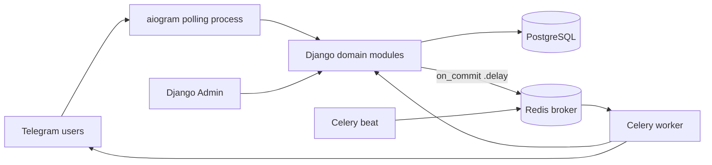

# TableOS — Architecture as implemented

**Status:** current implemented behaviour, verified against source at commit
`ddb7dce` (branch `clean-project-rules`, after roadmap batches B0–B3) on
2026-10-23 and updated for batch B3.1 the same day. This document describes what the code does today, not the intended
design. The intended design is in
[`TARGET_ARCHITECTURE.md`](TARGET_ARCHITECTURE.md); open defects are in
[`../audits/ARCHITECTURE_AUDIT.md`](../audits/ARCHITECTURE_AUDIT.md).

**Reference convention:** code is cited as `path:symbol` rather than by line
number, so that references survive ordinary edits. Line-numbered citations in
the audit register refer to the audit baseline commit `b17ce5b` and are kept as
historical evidence.

## System boundary and processes

TableOS is a Django 5 modular monolith: one PostgreSQL database, Redis, an
aiogram polling process and Celery workers. SQLite is available only as an
explicit local mode (`DJANGO_USE_SQLITE=true`); its locking behaviour is not
representative of PostgreSQL.



| Process | Entry point | Responsibility | Settings module by default |
|---|---|---|---|
| Django web/admin | `core/wsgi.py`, `core/asgi.py`, `core/urls.py` | Demo home page, `/admin/`, `/health/` | `core.settings.production` |
| Management commands, `runserver` | `manage.py` | Migrations, seeds, `runbot`, `ensure_admin` | `core.settings.local` |
| Telegram bot | `manage.py runbot` → `bot/main.py:run_polling` | Polls every active polling `BotInstance` in one process | `core.settings.local` (via `manage.py`) |
| Celery worker | `celery -A core.celery worker` → `core/celery.py` | Staff/guest notifications, broadcasts, metric refresh | `core.settings.local` |
| Celery beat | `celery -A core.celery beat` | `process-scheduled-broadcast-campaigns` (1 min), `refresh-daily-partner-metrics` (15 min) from `CELERY_BEAT_SCHEDULE` | `core.settings.local` |
| PostgreSQL 16, Redis 7 | `docker-compose.yml` | Durable data; Celery broker and result backend | — |

`docker-compose.yml` declares only `db`, `redis`, `web` (Django `runserver`)
and `worker`. It declares **no `runbot` and no `beat` service**, so a
compose-only environment does not poll Telegram, does not send scheduled
broadcasts and does not refresh daily metrics. There is no production web
server, no CI configuration and no deployment manifest in the repository.
Every non-web process falls back to `core.settings.local` (`DEBUG=True`)
unless `DJANGO_SETTINGS_MODULE` is set explicitly.

Queues: `default` and `broadcasts`; only
`notifications.send_broadcast_campaign` is routed to `broadcasts`. Because
`CELERY_TASK_QUEUES` is declared, a worker without `-Q` consumes both queues.

## Application modules and ownership

Installed apps, in order: `unfold`, Django contrib, `bot`, then `partners`,
`users`, `tables`, `menu`, `orders`, `billing`, `bonuses`, `employees`,
`notifications`, `analytics`. `core` holds shared bases, Admin scoping, Celery,
crypto, logging and settings.

| Area | Persisted concepts | Real orchestration | Notes |
|---|---|---|---|
| Partners | `Partner`, `BotInstance`, `PartnerBotSettings` | model `clean()`, `partners/services.py:rotate_bot_token` | `PartnerBotSettings` holds module flags, button labels and message templates. |
| Users / identity | `User`, global `TelegramAccount`, partner `GuestProfile`, `AdminAccessProfile`, `AdminSectionPermission` | `users/services.py:get_or_create_guest_profile` | One Telegram identity → one guest profile per partner. |
| Tables | `Table`, `TableSession` | `tables/services.py` | QR activation, settlement-gated close. `timed_out` and `expires_at` exist but nothing sets them. |
| Menu | `MenuCategory`, `MenuItem` | selectors/repositories only | Price must be positive (`menu_item_price_positive`). |
| Orders | `Cart`, `CartItem`, `Order`, `OrderItem`, `OrderStatusHistory` | `orders/services.py` | Cart lifecycle, order creation, status machine, guest receipt confirmation. |
| Billing | `BillingRequest`, `Bill`, `BillOrder`, `BillItem`, `Payment` | `billing/services.py` | Bill creation/extension, payment, bonus payment, post-payment settlement. |
| Bonuses | `BonusProgram`, `BonusTransaction`, `WalkInSale`, `WalkInSaleItem` | `bonuses/services.py`, `bonuses/strategies.py` | Ledger-backed balance with reconciliation guard; quick sale. |
| Employees | `EmployeeProfile` | `employees/selectors.py:get_staff_employee_by_telegram` | `services.py` is a docstring only. |
| Notifications | `NotificationPreference`, `StaffNotification`, `BroadcastCampaign` | `notifications/services.py`, `tasks.py` | All Telegram sending lives here. |
| Analytics | `PartnerDailyMetric` | `analytics/services.py` | On-demand day report for staff; 15-minute snapshot task. |

### Actual import dependencies

The target allows `tables → users` only and forbids `core → apps`. The code
today has these direct dependencies (production modules, excluding tests):

```text
bot           -> every domain app
analytics     -> billing, bonuses, orders, partners, tables, users
billing       -> bonuses, notifications, orders, partners, tables, users
orders        -> employees, menu, notifications, tables, users
tables        -> billing, bonuses, orders, users
notifications -> employees, orders, partners, tables, users
bonuses       -> menu, orders, users
core          -> partners, users (core/admin_mixins.py); orders, partners, tables (core/urls.py)
```

`apps.notifications.services ↔ apps.notifications.tasks` is a cycle broken
only by function-local imports. `core → apps` contradicts the rule in
`AGENTS.md` and is recorded as AA-031.

## Runtime and bot routing

`bot/main.py:create_dispatcher` registers `PartnerRuntimeMiddleware` as an
outer update middleware and then includes routers in this order: `start`,
`session`, `menu`, `order`, `profile`, `billing`, `guest_call`, `staff`.
aiogram stops at the first matching handler, so this order is behaviour.

1. `bot/services/runtime.py:load_active_bot_configs` runs once at `runbot`
   start. It refuses to start if any active `BotInstance` belongs to a
   non-active partner, uses webhook mode, has an undecryptable, placeholder,
   malformed or duplicated token. It builds a token → `BotRuntimeConfig` map.
2. For **every update**, `bot/middlewares/partner_runtime.py` calls
   `bot/services/context.py:resolve_partner_for_bot_token`, which reloads the
   `BotInstance` and `Partner`. A disabled bot instance drops the update
   silently; a suspended partner receives
   `Работа бота приостановлена, ожидайте обновлений.` (message or callback
   alert). The polling connection itself stays open until the process restarts.
3. Handlers call `resolve_partner_for_bot_token` again and build
   `bot/services/content.py:BotContent` from `PartnerBotSettings`.
4. Reply-keyboard actions are matched by exact text through
   `bot/filters/content.py:PartnerButtonFilter`; each filter evaluation reloads
   the partner and its content. `PartnerBotSettings.clean` rejects empty or
   duplicate routed labels.
5. Staff handlers resolve the actor through
   `bot/handlers/staff.py:_resolve_staff_employee_by_telegram_id` →
   `employees/selectors.py:get_staff_employee_by_telegram`, which requires an
   active `EmployeeProfile`, an active `User`, and `User.partner` equal to the
   bot partner. Every staff callback resolves the actor again and checks the
   relevant capability (`_can_manage_billing`, `_can_view_tables`,
   `_ensure_open_orders_allowed`, `_ensure_quick_sale_allowed`). Capabilities
   combine `User.role` with the partner's module flags.

All bot messages are sent with `ParseMode.HTML` (default bot properties in
`bot/main.py` and `notifications/services.py:_send_telegram_messages`). Since
B3.1, free-text values (venue, menu, guest, staff, comments, labels) are
escaped with `bot/utils/html.py:escape_html` in the bot and
`notifications/services.py:_escape_html` in notifications; partner templates
are trusted markup with escaped substituted values; broadcast text is sent as
partner-authored markup.

## Key domain flows

### Guest session, menu, cart and order

1. `/start table_<number>_<token>` → `tables/services.py:activate_table_session`
   (bot: `visit_choice="ask"`). Every session belongs to a **table visit**
   (`TableVisit`, ADR-0007): one party at a table; a table may have several
   active visits. If another party with a seated guest is at the table, the
   bot asks "Подсесть к компании (с HH:MM, гостей: N)" or "Начать новый
   визит" (`tv:j:<visit>` / `tv:n:<table>` callbacks, hex UUIDs); a guest who
   already sits in an active visit of the table stays in it. Service callers
   default to `auto` (join the party at the table, else start one). Starting
   a visit while another one of the table is open notifies staff
   (`StaffNotification` category `table_visit`). Activation locks
   `GuestProfile → Table → guest's own sessions → TableVisit`, closes the
   guest's previous active session in the partner **regardless of unpaid
   orders** (PQ-007), creates the new session and applies `VISIT` bonus
   programmes with idempotency key `table_session:<id>:program:<id>`. The
   partial unique constraint `unique_active_table_session_per_partner_guest`
   guarantees one active session per guest and partner. A visit closes by
   itself when nobody sits in it and it is settled (no unpaid orders, no open
   bill); `close_table_visit` is the staff command.
2. Cart commands in `orders/services.py` lock the guest's active `Cart`.
   A cart with items that belongs to an older session is abandoned; an empty
   one is moved to the new session. `unique_active_cart_per_partner_guest`
   allows one active cart per guest and partner.
3. Checkout → `create_order`, which validates that guest, table, session and
   every menu item belong to the partner, snapshots item names and the prices
   stored in the cart, writes `OrderStatusHistory` and creates
   `StaffNotification` rows dispatched with `transaction.on_commit`.
   Availability of menu items is checked when items are added to the cart,
   not again at checkout.
4. Staff status changes use `transition_order_status`, which reloads the order
   with `select_for_update()` and validates against `ORDER_STATUS_TRANSITIONS`:
   `new → accepted|canceled`, `accepted → preparing|ready|canceled`,
   `preparing → ready|canceled`, `ready → delivering|completed|canceled`,
   `delivering → completed|canceled`. Completion sets `received_at`.
5. Guest receipt confirmation (`confirm_order_received_by_guest`) locks the
   order and moves it to `completed` from any status in
   `GUEST_RECEIPT_CONFIRMABLE_STATUSES` (every non-final status, including
   `new`; owner decision PQ-029). This is the only guest-initiated transition;
   history records it as a guest action.

### Billing and settlement

1. A guest billing request (`create_billing_request_for_telegram_user`)
   either prepares a draft personal/shared bill (`auto_prepared`) or records a
   custom-split request (`open`) for staff. Staff can also build shared or
   personal bills per table from the bot or Admin.
2. Eligible orders are selected **by table visit** (since B3.2 part B):
   `get_table_billable_orders(visit_id=…)` returns the unbilled, not cancelled
   orders of that visit (`visit_id=None`: legacy orders without a visit).
   `create_bill_from_orders` rejects orders of different visits and stores
   `Bill.visit`; `attach_orders_to_bill` accepts only orders of the bill's
   visit. Guest requests use the guest's visit; staff/Admin table bills use an
   explicit visit or the table's single active visit
   (`resolve_table_visit_for_billing`; several active visits → staff picks).
   The guest "request bill" button follows the guest's visit.
3. `create_bill_from_orders` locks `Order → OrderItem`; `attach_orders_to_bill`
   locks `Bill → OrderItem`. `BillItem.unique_active_order_item_bill_allocation`
   allows one **active** allocation per `OrderItem`. Since B3.2 part A,
   staff with the owner-granted permission (or the owner) can remove lines
   (`remove_bill_lines`), void a bill without money payments (`void_bill`,
   which returns applied bonuses as a `reversal` ledger credit and reopens its
   requests) and cancel a billed order (`cancel_order`). Removed lines stay
   inactive for history; every change is a `BillAdjustment`. A bill with
   applied bonuses can only be voided; totals never drop below money paid;
   orders in paid bills cannot be cancelled.
   Bill creation locks orders with `select_for_update(of=("self",))`, because
   PostgreSQL rejects `FOR UPDATE` on the nullable `table` join (AA-033).
4. `record_payment` locks the bill, rejects bonus method, non-positive and
   over-remaining amounts, then sets `partially_paid` or `paid`.
   `pay_bill_with_bonuses` locks `Bill → Order → GuestProfile`, checks
   ledger/balance reconciliation, applies the partner cap at 1 bonus = 1 UAH
   and writes a `bonuses` payment only when the bill is fully covered.
   `Bill.paid_amount` counts money payments only.
5. When a bill becomes `paid`, `_process_post_payment_updates`, still inside
   the payment transaction: locks the bill's orders, completes `ready` and
   `delivering` orders, sets `paid_at`, accrues `ORDER_COMPLETED` programmes
   once per order (key `order_paid:<order_id>:program:<id>`), marks the bill's
   billing requests processed and, if
   `PartnerBotSettings.auto_close_table_session_after_payment` is on, runs
   `_close_settled_sessions_of_bill`: only sessions that own orders of this
   bill are candidates; a fully settled candidate has its pending requests
   marked processed and is closed; any other session stays open. This step
   never raises into the payment (PQ-027, fixed in B3.1).

Effective lock order of the payment path:
`Bill → Order → GuestProfile → BillingRequest → TableSession`. Bill changes:
`Bill → BillItem → GuestProfile → Order`.

### Loyalty and quick sale

`GuestProfile.loyalty_balance` is a cached projection of the immutable
`BonusTransaction` ledger. Every mutation locks the guest row, refuses to act if
the cached balance differs from the ledger (`assert_bonus_balance_reconciled`)
and then resynchronises it. Source-linked idempotency keys are unique per
partner. Quick sale (`register_walk_in_sale*`) requires a positive amount,
optionally redeems bonuses before accrual and accrues `MANUAL_PURCHASE`
programmes. `expires_at` is written on accruals but nothing expires bonuses.
The management command `apply_manual_purchase_bonus` accrues without a source
key, so re-running it accrues again.

### Notifications and broadcasts

- Staff notifications and guest order-status updates are queued with
  `transaction.on_commit` and delivered by Celery tasks that create a new
  aiogram `Bot` per call. Telegram errors are captured as a failed result and
  not re-raised, so `autoretry_for=(Exception,)` retries only unexpected
  errors. Neither task skips work that was already sent (AA-030).
- Guest calls (`request_staff_assistance`) target roles by `User.role` and use
  a check-then-create cooldown on recent notifications for the same table.
- Broadcasts: `send_broadcast_campaign` marks the campaign `scheduled` and
  enqueues it after commit. `send_broadcast_campaign_now` is
  `@transaction.atomic` and sends a batch of up to 250 recipients to Telegram
  **inside** that transaction (with `RetryAfter` sleeps), then chains the next
  batch by guest ID cursor. There is no lease, per-recipient delivery record or
  idempotency key (AA-008, open for B4).

## Data ownership, tenancy and authorization

Most domain models inherit `core/database/models.py:PartnerBoundModel`, which
adds only a `partner` foreign key. No database rule ties related rows to the
same partner (AA-002, PQ-020). Application-level checks exist in
`create_order`, the bonus services, billing locks scoped by `partner_id`, and
the bot's partner-derived lookups.

`core/admin_mixins.py:ScopedAdminMixin` scopes changelists, object
permissions, foreign-key/M2M choices and inline saves by the user's
`AdminAccessProfile.partner`, hides the `partner` list filter and `partner`
field from tenant users, and maps Admin sections to CRUD/sensitive
permissions. Superusers bypass scoping. Since B3.1 the tenant `UserAdmin`
excludes superusers and `OrderAdmin` keeps `guest`, `table` and
`table_session` read-only.

## States and protections actually enforced

| Concept | Transition mechanism | Durable or locked protection today |
|---|---|---|
| Order status | `transition_order_status`; `cancel_order`; guest confirmation; post-payment completion | Locked reload; staff transition table plus explicit guest confirmation rule; cancelling an order with active bill lines is refused |
| Table session | `activate_table_session`, `close_table_session_if_settled`, post-payment auto-close | Partial unique active session per guest; locks; no expiry processor |
| Table visit | activation (join/new/auto), automatic close when empty and settled, `close_table_visit` | Table row lock serialises visit creation/joining; visit row lock before joining and closing |
| Cart | cart services, checkout | Partial unique active cart per guest; cart row lock |
| Bill | create/attach/issue/payment/change/void services | Bill lock; one active allocation per order item; audited changes; void releases allocations |
| Billing request | `mark_billing_request_processed`, `cancel_billing_request` | Locked reload; processed and cancelled are terminal |
| Payment | `record_payment`, `pay_bill_with_bonuses` | Bill lock; positive and ≤ remaining; Admin cannot edit existing payments |
| Bonus ledger | bonus services, billing bonus payment | Guest lock; reconciliation guard; idempotency key unique per partner |
| Broadcast | notification service and task | None beyond status field (AA-008) |

Admin shows lifecycle, derived and ledger fields read-only for orders, carts,
bills, allocations, payments, sessions, guest balances and bonus
transactions; allowed operations are actions that call owner services.

## Tests and checks

- 250 tests after B3.2 part B, green on SQLite and on PostgreSQL 16. Nine
  are PostgreSQL-only and skipped on SQLite: concurrent order transition
  (`apps/orders/test_concurrency.py`); concurrent QR scans, two guests
  scanning an empty table, and paying a visit while a guest joins it
  (`apps/tables/test_concurrency.py`); concurrent bill allocation, bonus
  payment, final payment, void-vs-payment and cancel-vs-billing
  (`apps/billing/test_concurrency.py`). A migration test
  (`apps/tables/test_visit_migration.py`) drives the visit backfill backward
  and forward.
- Recorded runs are listed in
  [`../engineering/TESTING.md`](../engineering/TESTING.md).
- There is no CI pipeline; every check is run by hand.

## Codebase figures at `ddb7dce`

233 tracked Python files (22,828 lines), 31 numbered migrations, 20 test
modules. Largest non-test units: `bot/handlers/staff.py` (2,366 lines),
`apps/billing/services.py` (1,068),
`apps/partners/management/commands/seed_baseline_demo.py` (728),
`bot/keyboards/staff.py` (723), `apps/orders/services.py` (722),
`apps/analytics/services.py` (718). The audit-time inventory is preserved in
[`../audits/CODEBASE_INVENTORY.md`](../audits/CODEBASE_INVENTORY.md).
