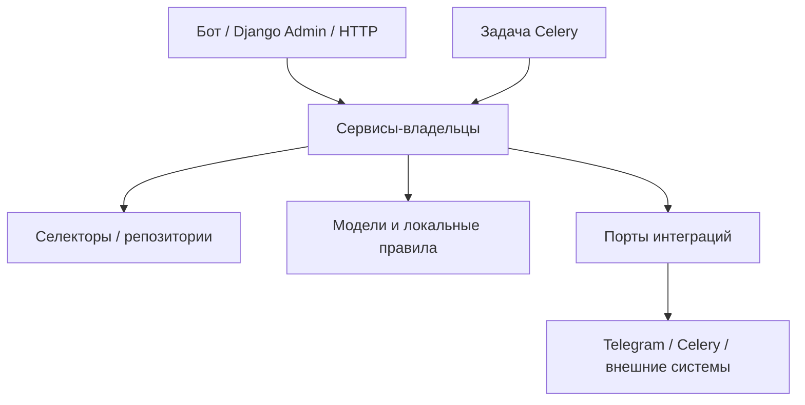

# Botera Shop — границы модулей

**Статус:** целевые правила модульного монолита. Сами по себе не разрешают
переносить код.

## Правило границы

Каждый бизнес-модуль владеет своими моделями, миграциями, сервисами
приложения, селекторами и собственными адаптерами интеграций. Вызывающий
выражает намерение через модуль-владелец, а не пишет в чужую модель и не
повторяет её жизненный цикл. Совместимость импортов сохраняется, пока
отдельная утверждённая миграция не получит характеризующие тесты и план
вывода из употребления.

| Модуль | Владеет | Может координироваться с | Не должен владеть |
|---|---|---|---|
| `partners` | жизненный цикл партнёра, настройки бота, контент, часы работы | users, employees, работа бота | жизненным циклом гостя, заказа, счёта |
| `users` | глобальная Telegram-личность и профиль гостя | tables, orders, bonuses | политикой прав партнёра |
| `tables` | столы, QR-токены, сессии и визиты стола | users, orders, bonuses | статусами заказов и расчётом оплаты |
| `menu` | категории и позиции, каналы продажи позиций | orders, представление бота | изменением корзины и заказов |
| `orders` | корзина, заказ, позиции заказа, статусы заказа, канал заказа | tables, menu, employees, notifications, billing | журналом оплат и изменением бонусного баланса |
| `billing` | ядро счёта (счёт, распределение, оплата, изменения); счета стола (`table_bills.py`); удалённые заказы (самовывоз, доставка, отправка): перевод заранее или оплата при получении, ТТН отправки (`remote_orders.py`) | orders, tables, bonuses, notifications | каталогом меню и политикой прав персонала |
| `bonuses` | программы, журнал бонусов, правила начисления и списания, быстрые продажи | users, billing, tables | переходами статусов счёта |
| `employees` | профиль сотрудника, роль, настройки, допуск к работе | partners, notifications, orders | изменением глобальной Telegram-личности без отдельной политики |
| `notifications` | долговечные уведомления, жизненный цикл рассылок, адаптер и задачи доставки | employees, orders, partners, tables, users | изменениями состояния в исходных доменах |
| `analytics` | модели чтения, агрегаты, отчёты, источники переходов и их журнал | все модули через явные договоры чтения | операционными записями в чужие агрегаты |
| `bot` | обработчики Telegram, представление DTO и клавиатур, маршрутизация | сервисы и селекторы модулей | бизнес-инвариантами и прямыми денежными записями |
| `core` | только действительно сквозные примитивы | все | доменными сущностями и циклами |

## Межмодульные договоры

Пока не утверждён явный внутренний механизм событий, межмодульный вызов
допустим, только если у него есть именованный сервис-владелец, понятная
граница транзакции и контекст партнёра/исполнителя. Сигнатура сервиса
получает ограниченные партнёром доменные объекты или доверенный
`partner_id`; она никогда не выводит права из произвольных данных
callback, глобальной Telegram-личности или непроверенного внешнего ключа.

Явные договоры для повторяющихся интеграций:

| Производитель | Потребитель | Направление | Что важно |
|---|---|---|---|
| Orders | Notifications | доменное событие после коммита | `on_commit` — хорошая основа. |
| Billing | Orders / Tables / Bonuses | расчёт счёта и списание с привязкой к источнику | Распределение и баланс сериализованы блокировками (B2–B3). |
| Tables | Bonuses | начисление за визит после корректной сессии | Одна активная сессия на гостя и идемпотентный источник (B2). |
| Partners | Bot | снимок возможностей и настроек | Живая проверка приостановки и прав (B1). |
| Notifications | Telegram | долговечное намерение доставки → воркер | Ввод-вывод без транзакции, идемпотентная доставка (B4). |
| Analytics | все домены | проекция только для отчётов | Без обратной записи в исходные агрегаты. |

## Целевое направление зависимостей

Обработчики, действия Admin и задачи — адаптеры; в них нет альтернативных
реализаций переходов жизненного цикла. Селекторы только читают.
Репозиторий оправдан, только когда собирает значимую границу хранения, а не
оборачивает однострочный запрос ORM. Общий доменный сервис не вводится
только ради того, чтобы убрать импорт.

## Устойчивые швы

1. **Партнёр и исполнитель.** Небольшой общий помощник может определить
   доверенного партнёра и исполнителя, но проверка владения остаётся в
   сервисе-владельце.
2. **Статус заказа.** Все записи статуса заказа идут через сервис-владелец с
   блокировкой; бот и Admin только передают намерение пользователя.
3. **Деньги.** Распределение по счетам, оплаты и изменения бонусного баланса
   идут через сервисы-владельцы с задокументированным порядком блокировок и
   неизменяемым журналом с привязкой к источнику.
4. **Уведомления.** Модули-источники создают долговечное намерение доставки
   после коммита; воркер выполняет ввод-вывод Telegram вне исходной
   транзакции.
5. **Admin.** Django Admin показывает данные партнёра и вызывает
   утверждённые действия сервисов. Свободно править поля статусов, журналов,
   распределений и сумм в нём нельзя.
6. **Каналы заказа (ADR-0009).** Одна модель заказа, счёта и оплаты; канал —
   атрибут, поведение канала — модуль своего семейства.

## Правила защиты от разрастания

- Не делать `bot` доменным слоем; типы aiogram не попадают в доменные
  сервисы.
- Не позволять одному модулю обновлять чужой агрегат через
  `QuerySet.update()`.
- Не передавать через границу модуля голый идентификатор, где нужен поиск с
  учётом партнёра.
- Не сваливать несвязанные модули в новый пакет `common`, `utils` или
  `services`.
- Не считать, что ограничение Admin по партнёру делает запись жизненного
  цикла безопасной: права и соблюдение инвариантов — разные обязанности.
- Не создавать шину событий, outbox, подсистему CQRS или иерархию
  репозиториев, пока утверждённый батч не обоснует более узкую потребность.
