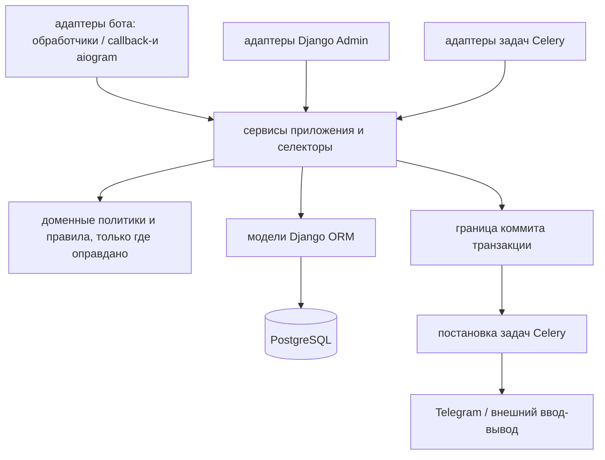

# Botera Shop — целевая архитектура

**Статус:** целевое состояние, архитектурный договор.
**Владелец:** команда Botera Shop.
**Основание:** результаты аудита `docs/audits/ARCHITECTURE_AUDIT.md` и решения в `docs/decisions/`.

## 1. Цель и границы

Botera Shop остаётся **модульным монолитом** на Django, aiogram и Celery. Это намеренное решение: один развёртываемый продукт, общая транзакционная база для денежных и операционных процессов и небольшой набор тесно связанных предметных областей не оправдывают разбиения на сервисы. Связь с другими продуктами сети Botera (Master, Partnership, Discovery) — только через API и события, и она никогда не обязательна для заказа или оплаты (`docs/product/ECOSYSTEM_DIRECTION.md`).

Цель — сделать существующие предметные правила явными и проверяемыми без «чистой архитектуры ради папок». В частности, архитектура должна предотвращать подтверждённые аудитом риски: связи между разными партнёрами, обход жизненного цикла через Django Admin, повторные денежные операции и отправки, устаревшие права сотрудника и ввод-вывод внутри транзакции.

Это не план переписывания приложения. Django ORM, Django Admin, роутеры aiogram, Celery и существующие публичные пути импорта сохраняются до отдельно согласованной миграции.

## 2. Карта модулей

Каждый бизнес-объект принадлежит одному `Partner`, если только он не явно глобальная личность. Владение и допустимые зависимости — ниже.

| Модуль | Ответственность | Может зависеть от |
| --- | --- | --- |
| `partners` | корень партнёра, настройки бота, настройка модулей и возможностей, часы работы | `core`, `users` |
| `users` | глобальная Telegram-личность и профиль гостя в пределах партнёра | `core`, `partners` |
| `employees` | профиль сотрудника, роль, доступ и смены | `core`, `partners`, `users` |
| `tables` | QR, сессия и визит стола, контекст гостя за столом | `core`, `partners`, `users` |
| `menu` | категории и позиции меню, каналы продажи позиций | `core`, `partners` |
| `orders` | корзина, заказ, позиции, статус и канал заказа | `core`, `employees`, `menu`, `partners`, `tables`, `users` |
| `billing` | счета, запросы, оплаты, распределение позиций; модули каналов (`table_bills`, `remote_orders`) | `core`, `orders`, `partners`, `tables`, `users` |
| `bonuses` | программы, журнал и применение бонусов | `core`, `orders`, `partners`, `users` |
| `notifications` | уведомления персонала и гостей, рассылки | `core`, `employees`, `orders`, `partners`, `tables`, `users` |
| `analytics` | модели чтения и отчётные снимки | все доменные модули только на чтение |
| `bot` | адаптер Telegram, работа процесса, маршрутизация и представление | API приложения всех нужных модулей |
| `core` | общие технические примитивы, ограничение Admin, базовые классы, логирование | не зависит от доменных приложений |

`analytics` не становится владельцем доменной записи и не вызывает команды, меняющие чужое состояние. В `bot` нет доменных инвариантов: обработчики переводят обновление Telegram в типизированную команду или запрос и показывают результат.

Каналы заказа (ADR-0009): одна модель заказа, корзины, счёта и оплаты на все каналы; канал — атрибут (`Order.channel`, `Cart.channel`), данные канала — поля заказа, поведение канала — модуль его семейства. Ядро счёта про каналы не знает.

## 3. Нормативные слои

Слои описывают назначение, а не обязательную глубину каталогов. Новый слой вводится, только когда у него есть отдельная ответственность и потребитель.

| Слой | Разрешённая ответственность | Не должен делать |
| --- | --- | --- |
| Адаптер | обработчики, клавиатуры и фильтры `bot`, Admin, management-команды, точки входа задач Celery | реализовывать правила денег и состояний или делать запросы ORM без партнёра |
| Сервис приложения | команды, транзакционные сценарии, проверка прав, оркестрация, доменные события | рисовать интерфейс Telegram или прятать долгий процесс в задаче |
| Селектор | запросы только на чтение в пределах партнёра, DTO и модели чтения | изменять модели или подменять доменную команду |
| Доменная политика или правило | детерминированное правило, применимое в нескольких сценариях | выполнять ввод-вывод и запросы ORM без явного шлюза или быть пустой «абстракцией» |
| Репозиторий | только для сложной границы хранения или запросов с несколькими потребителями | дублировать простой селектор или быть фасадом над одним `objects.filter` |
| Модель | локальные данные, ограничения базы, простые проверки модели | координировать межмодульный бизнес-процесс |
| Задача | короткий повторяемый адаптер с идемпотентным входом | держать сетевой вызов внутри доменной транзакции или решать вопрос прав |

### 3.1. Направление зависимостей

* `core` не импортирует `apps.*` и `bot`.
* Доменный модуль не обращается к модели другого модуля из адаптера; он вызывает опубликованный API приложения владельца или явно разрешённый селектор чтения.
* Циклические импорты между `services`, `tasks` и обработчиками не допускаются. Задача получает стабильный идентификатор команды, а не импортируется внутри доменного сервиса для обратного вызова.
* `interfaces.py`, `repositories.py`, `policies.py`, `rules.py` и `engine.py` создаются только с задокументированным потребителем. Пустой или чисто косметический интерфейс — не слой.

### 3.2. Публичные API модулей

Стабильная поверхность — именованные команды и селекторы и задокументированные пути импорта. Внутренний перенос выполняется так:

1. новый API и характеризующие тесты появляются до переноса;
2. старый путь импорта остаётся тонким реэкспортом с предупреждением об устаревании;
3. все собственные потребители переходят на новый путь;
4. удаление допускается только после поиска статических и динамических (Django, Celery, aiogram) потребителей и согласованного периода совместимости.

## 4. Изоляция партнёров и доступ

### 4.1. Инвариант владения

Для любой команды с привязкой к партнёру одновременно выполняется:

1. исполнитель, цель и все переданные связанные объекты принадлежат одному `Partner`;
2. партнёр выводится из авторизованного контекста, а не из данных callback или поля формы;
3. селектор фильтрует по `partner_id` в самой точке запроса;
4. создание и обновление проверяют связи между моделями;
5. важные инварианты после отдельной миграции данных дублируются на уровне PostgreSQL.

Обычный `CheckConstraint` не может надёжно сравнить поля двух таблиц. Для принадлежности между таблицами после аудита данных выбирается один явно задокументированный механизм: составные внешние и уникальные ключи, ограничение-триггер или денормализованный `partner_id` с проверяемой согласованностью. Решение должно быть обратимым миграцией и сопровождаться проверками существующих данных. До соблюдения на уровне базы проверка в сервисе приложения обязательна, а не временно необязательна.

### 4.2. Права

* Пользователь Telegram — глобальная личность; профили гостя и сотрудника — роли в пределах партнёра. Менять Telegram ID и пользоваться прямым Admin глобального `TelegramAccount` может только суперпользователь. Владелец заведения (и сотрудник с выданным разделом «Сотрудники») может менять `@username` и поля профиля своего сотрудника; владелец также меняет имя пользователя и имя пользователя заведения через ограниченный `UserAdmin`. Поскольку `@username` хранится в глобальной личности, это одобренное владельцем изменение видно во всех её контекстах. Данные из обновления Telegram остаются доверенной синхронизацией от платформы Telegram.
* Доступ сотрудника требует одновременно активного `User`, активного `EmployeeProfile`, правильной связи с партнёром и нужного права. Все обработчики callback заново проверяют право в момент действия, а не только при построении клавиатуры.
* `Partner.status=suspended` проверяется при разборе каждого обновления и сессии, а не только при старте процесса бота. Приостановленный партнёр получает стандартный ответ «работа приостановлена»; при `BotInstance.is_active=False` обновление не обрабатывается, а транспорт polling останавливается при перезапуске процесса.
* Django Admin использует тот же ограниченный API команд и запросов. Фильтры списков, внешние ключи и формы inline не должны раскрывать других партнёров; отсутствие права на объект само по себе не считается достаточной изоляцией.

### 4.3. Роли и настройка

`UserRole` и `EmployeeProfile` — источник доменных полномочий. `AdminAccessProfile` ограничивает доступ к бэк-офису, но не заменяет проверку активного профиля сотрудника и права на раздел. Правило «кто может выполнить команду» живёт в сервисе приложения или политике, а не в одном конкретном обработчике Telegram.

## 5. Деньги, жизненный цикл и Admin

У денежных процессов (заказ, счёт, позиция счёта, оплата, бонусный журнал) одна командная точка входа. Состояние не меняется прямой правкой полей в Admin, через `.update()` выборки или nullable-связь.

| Область | Целевой инвариант |
| --- | --- |
| Заказ | статус меняется по таблице разрешённых переходов на заблокированной текущей строке; история и уведомление создаются ровно один раз |
| Счёт и оплата | изменение счёта и запись оплаты сериализуются в пределах счёта и гостя; сумма, статус и закрытие сессии вычисляются в одной команде |
| Распределение позиции | одно активное распределение на `OrderItem`; конкурентные команды не могут прикрепить позицию к двум счетам |
| Бонусы | журнал только дописывается; баланс меняется только командой, которая блокирует гостя и имеет ключ идемпотентности или идентификатор корреляции |
| Admin | финальные записи и журнал — только для чтения; разрешённые операции — явные действия Admin, вызывающие тот же сервис и фиксирующие исполнителя и причину |

Для каждой команды определяются: исполнитель, граница партнёра, смысл идемпотентности, набор блокировок, разрешённый исходный статус, побочные эффекты после коммита и наблюдаемый след аудита. Прежде чем включать ограничение базы, миграция проверяет и исправляет или изолирует старые данные по согласованному плану.

## 6. Транзакции, конкуренция и фоновая работа

### 6.1. Транзакция команды

Команда открывает короткую `transaction.atomic()` только для чтения, проверки и изменения локальных строк. Она получает актуальные строки через `select_for_update()` в стабильном порядке и не использует объект, загруженный до блокировки, как источник правды. Конкурентно изменяемые сценарии покрываются тестами на PostgreSQL: повторный callback, параллельный скан, прикрепление позиции к счёту, оплата и списание бонусов.

B2 зафиксировал порядок блокировок жизненного цикла для поддержанных
команд: активация сессии — `GuestProfile → Table → активные TableSession →
TableVisit`; смена статуса заказа блокирует канонический `Order`; завершение
оплаты — `Bill → Order → GuestProfile → BillingRequest → TableSession →
TableVisit` (`GuestProfile` блокируется начислением бонуса за оплаченный
заказ; уточнено 2026-10-23). Частичное уникальное ограничение на активную
сессию применяется только после аудита дублей. Тесты на SQLite не заменяют
доказательств конкурентности на PostgreSQL.

B3 добавил командную границу для оплаты бонусами: `pay_bill_with_bonuses`
блокирует `Bill → Order → GuestProfile`, сверяет кэш баланса с бонусным
журналом партнёра, применяет лимит программы партнёра по курсу 1 бонус =
1 грн и либо оставляет денежный остаток к оплате, либо — при полном покрытии —
записывает обычную оплату способом `bonuses` на номинал бонусов.
`Bill.paid_amount` учитывает только денежные оплаты. В боте это одно
действие «Оплатить бонусами»; другого пути через Admin для расчёта бонусами
нет. Начисление бонусов после оплаты заказа — текущая базовая привязка
события, а не общее ограничение для будущих программ партнёра.

### 6.2. Внешние эффекты

Telegram и другой сетевой ввод-вывод запускаются **после успешного коммита**. `transaction.on_commit()` публикует долговечную команду или задание, а задача доставляет его с ключом идемпотентности. Паузы, циклы повторов и сетевые запросы внутри открытой транзакции запрещены.

Для рассылок и других процессов «один ко многим» используется запись состояния доставки: аренда кампании или задания, стабильная личность получателя, ключ сообщения или доставки, число попыток, итог и курсор или раздел. Повтор задачи и два воркера не дают повторной отправки и двойного счётчика. Уведомления перед отправкой заново проверяют актуальный доступ и настройки получателя, когда этого требует продукт.

### 6.3. Celery и планировщик

Зарегистрированные задачи документируются вместе с событием запуска, идемпотентностью, политикой повторов и владельцем. Периодические задания должен запускать реальный процесс планировщика; документация compose и развёртывания явно различает web, worker, bot и beat. Невыполняемая задача не считается поддержанной функцией.

## 7. Работа бота

Процесс загружает только неизменяемую конфигурацию, нужную для подключения. Контекст обновления всегда заново определяет партнёра, статус, исполнителя и право. Данные callback несут идентификатор и короткое намерение, но никогда не доказывают партнёра, сотрудника или право.

Маршруты по тексту и кнопкам, настроенным партнёром, не используют неоднозначное точное совпадение без пространства имён или ключа маршрута. Изменение текстов проверяет уникальность ключа маршрута и совместимость с зарегистрированным обработчиком. Если совпадений может быть несколько, роутер обязан давать детерминированный проверяемый результат либо отклонить конфигурацию.

## 8. Стратегия миграции

Работа идёт небольшими батчами из `docs/audits/REFACTOR_ROADMAP.md`:

1. характеризующие тесты и наблюдаемость;
2. защиты высокорисковых сервисов и ограничения Admin;
3. заполнение и аудит данных, затем ограничения базы и защита от конкуренции;
4. выравнивание работы бота и задач;
5. только после этого — упрощение пустых абстракций и чистка документов.

У каждого батча есть откат, проверки инвариантов, проверка на PostgreSQL и список публичных путей импорта. Нельзя объединять структурный перенос с изменением бизнес-смысла без отдельного ADR или решения владельца.

## 9. Когда архитектурное изменение готово

Изменение готово, только если:

* указаны модуль-владелец и слой;
* все входы проверены на границу партнёра и права;
* граница транзакции, набор блокировок, идемпотентность и побочные эффекты команды задокументированы;
* у Django Admin и бота нет альтернативного небезопасного пути;
* есть регрессионный или характеризующий тест в нужной среде, включая PostgreSQL для конкуренции и ограничений базы;
* проверены динамические потребители (Admin, роутер, autodiscovery Celery, management-команда);
* обновлены канонические документы и, при изменении правила, ADR.

## 10. Что явно не является целью

* не выделять микросервисы или отдельные базы без измеримой эксплуатационной необходимости;
* не добавлять репозиторий, интерфейс или политику только ради единообразного имени файла;
* не заменять Django ORM самописной абстракцией хранения;
* не считать документацию или локальный SQLite достаточным доказательством корректности сценариев с партнёрами, деньгами и конкуренцией.
